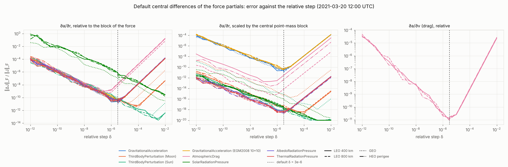
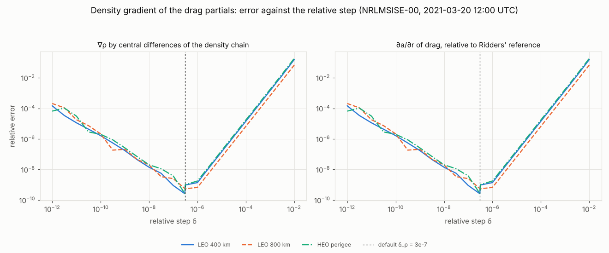

# Covariance Propagation Provenance

This page traces every equation implemented for the state transition matrix and covariance work (phase 2,
feature 1), including the frame-change velocities that the covariance work relies on. For each one it gives the quantity, where it is implemented, the published reference it comes from,
the tests that check it, and the status of the citation:

- **Verified on the text**: the cited passage was read and matches the implementation.
- **To be verified by S. Guillet**: the reference could not be read from the development environment. The
  implementation is checked by the listed tests, and the citation awaits confirmation on the text.
- **Confirmed by S. Guillet**: a citation of the previous kind that S. Guillet has confirmed, with the date.

Rows are added by each pull request that implements an equation. A formula of the new code that is missing from
this page is a defect.

## Equations

| Quantity | Implementation | Reference | Tests | Citation status |
|----------|----------------|-----------|-------|-----------------|
| Angular velocity of a frame transform: ICRF relative to the frame, in the frame axes, so that `R(t + dt) = R(t) exp(-[ω×] dt)` | Native `TransformFrameProxy` (SPICE `sxform_c`, then `xf2rav_c`), composed by `Frames/Frame.cs`, `Frame.ToFrame` | NAIF, `xf2rav_c` documentation: angular velocity of the second frame relative to the first, expressed in the first. | `FrameChainIntegrationTests.SpiceFrameRotationFollowsItsAngularVelocity` (ITRF93, IAU_MOON, MOON_ME, DSS-13_TOPO; below 2e-13 rad over 1 s) | Convention measured on the SPICE frames by the listed test. NAIF text: confirmed by S. Guillet (2026-10-07). |
| Velocity of a frame change, `r' = R r`, `v' = R v - (R ω) × r'` | `OrbitalParameters/OrbitalParameters.cs`, `OrbitalParameters.ToFrame` | Transport theorem, with `ω` of `Frame.ToFrame` brought into the target frame by `R`. Same map as the SPICE state transformation matrix `[[R, 0], [dR/dt, R]]` (NAIF, `sxform_c` documentation), with `dR/dt = -[(R ω)×] R`. | `StateVectorFrameVelocityTests` (geocentric Moon against SPICE in ITRF93, both directions, 2000 and 2021; DSS-13 against SPICE; 1e-12), `FrameTests.StateInSiteFrameMatchesSpiceTopocentricFrame` | Checked against SPICE states (a few 1e-16). NAIF text: confirmed by S. Guillet (2026-10-07). |
| Angular velocity of TIRS, `(0, 0, -Ω)` in TIRS axes, `Ω = 2π × 1.00273781191135448 / 86400` rad/s | `Frames/TirsFrame.cs`, `TirsFrame.EarthRotationRate` | IAU SOFA, `iauPvtob`, release 2023-10-11: constant `OM` and velocity `Ω ẑ × r` of an Earth-fixed point in the CIRS. The precession-nutation rate of the CIP is left out, as in `iauPvtob`. | `TirsFrameTests.TirsAngularVelocityDirectionIsNearZAxis`, `TirsFrameTests.TirsAngularVelocityMatchesFreshRecomputationOverOneSecond`, `FrameChainIntegrationTests.TirsAngularVelocityMatchesItrf93` (5e-11 rad/s), `FrameChainIntegrationTests.PointFixedInTirsMovesAtTheDerivativeOfItsIcrfPosition` (1e-6) | Verified on the text (`external-lib/sofa-src/pvtob.c`). |
| Angular velocity of CIRS, `-2 q⁻¹ dq/dt` for `q` the CIRS to ICRF rotation, by central difference over ±100 s (rounding and truncation both near 1e-7 of the rate) | `Frames/CirsFrame.cs`, `CirsFrame.ComputeAngularVelocity` | Quaternion kinematics in the Hamilton convention, `dq/dt = ½ q ⊗ ω_B` for the angular velocity `ω_B` of the rotating frame in its own axes: J. Solà, *Quaternion kinematics for the error-state Kalman filter*, arXiv:1711.02508, 2017. The sign gives the angular velocity of ICRF relative to CIRS, the convention of the first row. | `CirsFrameTests.CirsAngularVelocityMatchesFreshRecomputationOverOneSecond` (1e-12 rad), `FrameChainIntegrationTests.PointFixedInCirsMovesAtTheDerivativeOfItsIcrfPosition` (1e-5) | Checked by the listed tests. Solà (2017): confirmed by S. Guillet (2026-10-07). |
| Angular velocity of a site frame, the body-fixed one rotated into topocentric axes | `Surface/SiteFrame.cs`, `SiteFrame.GetStateOrientationToICRF` | A frame fixed in the body frame shares its angular velocity; topocentric axes north, west, zenith, as the SPICE topocentric frames (`earth_topo_201023.tf`). | `FrameTests.SiteFrameMatchesSpiceTopocentricFrame` (1e-16 rad/s against DSS-13_TOPO), `FrameTests.SiteFrameDoesNotRotateRelativeToItrf93` | Checked against the SPICE frame DSS-13_TOPO. |
| Jacobian of a frame change of a state, `J = [[R, 0], [-[(R ω)×] R, R]]` | `Math/Matrix.cs`, `Matrix.CreateStateTransformationJacobian`; used by `OrbitalParameters.ToFrame` | Exact derivative of the velocity row above, a map linear in `(r, v)` at a fixed epoch. Same block structure as the SPICE state transformation matrix (NAIF, `sxform_c` documentation) and as the ECI to ECEF covariance transformation of D. A. Vallado, *Covariance Transformations for Satellite Flight Dynamics Operations*, AAS 03-526, 2003. | `StateVectorFrameCovarianceTests.ToFrame_RotatingFrame_JacobianMatchesFiniteDifferences`, `MatrixTests.CreateStateTransformationJacobian_*` | Derivation checked by central differences (1e-9). SPICE `sxform_c`, Vallado (2003): confirmed by S. Guillet (2026-10-07). |
| Covariance through a linear map, `P' = J P Jᵀ`, then `(P' + P'ᵀ) / 2` | `Math/Matrix.cs`, `Matrix.TransformCovarianceWithJacobian`, `Matrix.Symmetrize` | Covariance of a linear transformation of a random vector, `Cov(J x) = J Cov(x) Jᵀ`: B. D. Tapley, B. E. Schutz, G. H. Born, *Statistical Orbit Determination*, Elsevier, 2004, chapter 4; Vallado (2003), op. cit. The symmetrization follows the rule of the feature specification (C2): every published covariance is symmetrized. | `StateVectorFrameCovarianceTests.ToFrame_RotatingFrame_CovarianceIsTransformedWithTheFiniteDifferenceJacobian`, `..._RoundTripThroughRotatingFrame_RestoresStateAndCovariance`, `..._CovarianceIsSymmetricPositiveSemiDefinite`, `MatrixTests.TransformCovarianceWithJacobian_*`, `MatrixTests.Symmetrize_*` | Confirmed by S. Guillet (2026-10-07). |
| Covariance in RTN, pure rotation `diag(R, R)` (unchanged, now documented) | `OrbitalParameters/StateVector.cs`, `StateVector.RotateCovarianceToRtn`, `StateVector.RotateCovarianceFromRtn` | Convention of the RTN covariance at TCA in the CCSDS Conjunction Data Message (CCSDS 508.0-B-1), used by the conjunction analysis and the CDM export. The rotation rate of the RTN frame is not applied. | `StateVectorTests.RotateCovarianceToRtn_DiagonalCovariance`, `ConjunctionAssessmentTests` | Confirmed by S. Guillet (2026-10-07). |
| Default state partials of a force (B1): central differences of the acceleration at the fixed epoch of the state, column `j` = `(a(x + h e_j) - a(x - h e_j)) / ((x_j + h) - (x_j - h))`, with `h_r = δ_r max(L, 1 m)`, `h_v = δ_v max(|v|, 1 m/s)`, `δ_r = δ_v = 3e-6`; `L` is the length on which the force varies (`ForceBase.PositionStepScale`): `|r|` by default, the distance to the reflecting body for albedo and the distance to the nearest occulting body for SRP, so that the step does not depend on the observer of the state (in SSB mode, `|r|` relative to the Sun gave 450 km near the Earth: H3 review of #378). In the geocentric mode these distances are `|r|` bit for bit, so the step study is unchanged; the velocity columns are skipped for a force that does not depend on the velocity | `Propagator/Forces/ForceBase.cs`, `ForceBase.AccumulateStatePartials` (default of every force without analytic partials, including forces written outside the library) | Central difference, and division by the difference of the perturbed components as stored to remove the representation error of the step: W. H. Press, S. A. Teukolsky, W. T. Vetterling, B. P. Flannery, *Numerical Recipes*, 3rd edition, Cambridge University Press, 2007, section 5.7. Steps from the [step study](#finite-difference-steps) below. | `ForceBasePartialsTests` (force of known Jacobian, non-linear in `r` and linear in `v`, at the four reference states: below 1e-8), `FiniteDifferenceStepStudyTests` | Steps measured by the study. *Numerical Recipes*: confirmed by S. Guillet (2026-10-07). |
| Parameter partials (B1, exact since step 5b): `∂a/∂C` is the acceleration with `C = 1`, the other quantities of the evaluation context unchanged, for the drag coefficient `Cd` and the reflectivity coefficient `Cr`; `Cr` is shared by SRP, albedo and thermal pressure, so `∂a/∂Cr` sums their three contributions. No division by the coefficient, so `C = 0` is covered; one evaluation per coefficient. Until step 5b, a central difference on the coefficient (`h_p = 1e-3 max(|C|, 1)`) | `Propagator/Forces/ForceBase.cs`, `ForceBase.AccumulateParameterPartialsCore`; `ForceEvaluationContext` | Every force with a coefficient multiplies the rest of its acceleration by it (drag, SRP, albedo, thermal; `Parameters` is internal, so no other force has one), so the acceleration per unit coefficient is the derivative. | `DragPartialsTests.DragCoefficientPartial_MatchesRidders` (2e-16 to 4e-16), `RadiationPressurePartialsTests.ReflectivityPartials_AddUpToRiddersOfTheSum` (sum of the three against Ridders' derivative of the summed acceleration, 1.5e-17 to 6.1e-16); tolerance 1e-12. `ForceParameterPartialsTests` (`a / Cd`, `a / Cr` and their sum, below 1e-10; `Cd = 0`), `ForceEvaluationContextTests` (the acceleration scales exactly with the mass and the coefficient) | Linearity checked bit for bit by the listed tests. |
| Point-mass partials of the central body (B2), `∂a/∂r = μ (3 r rᵀ / |r|⁵ - I / |r|³)`, with `μ` and `r` relative to the attracting body, as in the acceleration | `Body/PointMassPartials.cs`, `GravitationalField.TryAccumulatePositionPartials`, `CelestialItem.TryAccumulateGravitationalPositionPartials`, `GravitationalAcceleration` | O. Montenbruck, E. Gill, *Satellite Orbits: Models, Methods and Applications*, Springer, 2000, chapter 7 (variational equations). | `GravitationalAccelerationPartialsTests` against Ridders' reference: geocentric states 1e-13 to 2e-12; states relative to the Sun, with and without the ephemeris cache, 2e-10 to 1e-8 (limited by the resolution of heliocentric positions); tolerance 1e-6 | Confirmed by S. Guillet (2026-10-07). |
| Geopotential partials (B3): the Cunningham functions `V_nm`, `W_nm` to degree `N + 2` in the body-fixed frame, by `V_00 = R / r`, `V_mm = (2m - 1)(x R / r² V_(m-1,m-1) - y R / r² W_(m-1,m-1))`, `W_mm = (2m - 1)(x R / r² W_(m-1,m-1) + y R / r² V_(m-1,m-1))`, `V_nm = ((2n - 1) z R / r² V_(n-1,m) - (n + m - 1) R² / r² V_(n-2,m)) / (n - m)` (same for `W`); with `E_nm = V_nm + i W_nm` and `U = (GM / R) Σ (C_nm V_nm + S_nm W_nm)`, the relations `(∂x + i ∂y) E_nm = -E_(n+1,m+1) / R`, `(∂x - i ∂y) E_nm = (n - m + 2)(n - m + 1) E_(n+1,m-1) / R`, `∂z E_nm = -(n - m + 1) E_(n+1,m) / R`, applied twice, give the second derivatives from `E_(n+2,m-2)` to `E_(n+2,m+2)`; for `m = 0` and `m = 1` the orders below zero come from `E_n0` being real. The block is brought back to the frame of the state by `Rᵀ H R`, `R` the rotation of the acceleration (`Frame.RotationTo`, below), upper triangle mirrored, plus the point mass (B2) | `Body/GeopotentialGravitationalField.cs`, `TryAccumulatePositionPartials`, `HarmonicPartials`, `CunninghamFunctions`, `AddRotatedBack`; `GravitationalAcceleration` | Montenbruck and Gill (2000), op. cit., chapter 3 (recursions of the Cunningham functions and the acceleration of the geopotential, from the same relations) and chapter 7 (partials of the acceleration, Cunningham functions to degree `n + 2`). Compared term by term, without copying code, with CNES PATRIUS 4.16 (Apache 2.0), `GravityToolbox.computeDAccDPos` and its cases `m = 0`, `m = 1`, `m ≥ 2`, read on the source on 2026-10-10. | `GeopotentialPartialsTests.AnalyticPartials_MatchRiddersWithin1e8`: the four states of B7 and two near the pole (87.1° and 89.96° of latitude), EGM2008 to degree 2, 10 and 70, against Ridders' derivative of the acceleration (computed by the field in spherical coordinates): whole block 4.4e-13 to 1.7e-12, harmonics alone 2.0e-11 to 9.3e-11, and 2.0e-9 at GEO, where the reference resolves no better; tolerance 1e-8 (specification). `..._AreSymmetricAndSatisfyLaplace` (symmetric bit for bit, by construction since the upper triangle is mirrored; trace of the harmonics 4.1e-13 of their norm at most, also by construction since every term of the sum has a zero trace: these two tests guard the implementation against a change, they are not independent checks, which come from Ridders' reference); `..._StateInAnotherFrame_GivesTheRotatedPartials` (6.5e-16); `GeopotentialVariationalTests.Leo_PhiMatchesCentralDifferencesOfWholePropagations` (EGM2008 10×10 1.5e-8, 70×70 1.3e-8, tolerance 1e-7) | PATRIUS: compared on the source (2026-10-10). Montenbruck and Gill: confirmed by S. Guillet (2026-10-12). |
| Rotation of the geopotential acceleration and of its partials to the body-fixed frame, without allocation: `targetToICRF.Conjugate() * sourceToICRF`, the composition of `Frame.ToFrame`, with each rotation to ICRF from the orientation cache active on the thread (`PropagationFrameOrientationCache.GetRotation`, the same SLERP as `GetOrientation`) or, for ICRF itself, the identity; shared by `ComputeGravitationalAcceleration` and `TryAccumulatePositionPartials` (H3 of #369) | `Frames/Frame.cs`, `Frame.RotationTo`, `Frame.GetRotationToICRF`; `Propagator/PropagationFrameOrientationCache.cs`, `GetRotation` | Same formula as `Frame.ToFrame` (first rows of this page); ICRF to ICRF is the identity, which SPICE returns exactly. | `FrameRotationTests`: SPICE gives (1, 0, 0, 0) bit for bit for ICRF to ICRF; `RotationTo` equals the rotation of `ToFrame` bit for bit for SPICE frames, the IAU chain and equal frames, with and without the cache, and allocates nothing with it; a frame that does not read the cache (TIRS) keeps its own orientation. `GeopotentialPartialsTests.AccelerationAndPartials_WithTheOrientationCacheOfAPropagation_AllocateNothing` (0 bytes each, 96 to 224 bytes per call before); the goldens unchanged bit for bit | Not applicable (same composition, checked bit for bit). |
| Angular velocity of the body-fixed frame for atmospheric drag, without allocation: `targetToICRF.AngularVelocity.Inverse().Rotate(rotation.Conjugate()) + sourceToICRF.AngularVelocity`, the composition of `Frame.ToFrame`, with each orientation to ICRF from the orientation cache active on the thread (`PropagationFrameOrientationCache.GetRotationAndAngularVelocity`, the same interpolation as `GetOrientation`) or, for ICRF itself, the identity and a zero angular velocity | `Frames/Frame.cs`, `Frame.AngularVelocityTo`, `Frame.GetRotationAndAngularVelocityToICRF`; `AtmosphericDrag.GetRelativeState` | Same formula as `Frame.ToFrame` (first rows of this page); SPICE returns exactly a zero angular velocity for ICRF to ICRF. | `FrameRotationTests`: SPICE gives (0, 0, 0) bit for bit for ICRF to ICRF; `AngularVelocityTo` equals the angular velocity of `ToFrame` bit for bit for SPICE frames, the IAU chain and equal frames, with and without the cache, and allocates nothing with it; TIRS keeps its own orientation | Not applicable (same composition, checked bit for bit). |
| Unnormalized coefficients of the partials, `C_nm = N_nm C̄_nm`, `S_nm = N_nm S̄_nm`, `N_nm = √((2 - δ_0m)(2n + 1)(n - m)! / (n + m)!)`, the factorial ratio as a running product square-rooted before it can overflow; degree of the partials at most 120, above which they throw | `GeopotentialGravitationalField.NormalizationFactor`, `EnsurePartialsTables`, `MaxPartialsDegree`, `PartialsDegree` | The geodesy normalization of the field (`LegendreFunctions`). The coefficients of Montenbruck and Gill's recursion are unnormalized. Guard measured: at degree 120, at the equatorial radius, the largest `|V_nm|`, `|W_nm|` is 2.7e238 and the smallest `N_nm` 1.1e-233, more than ten orders of magnitude inside the range of a double on both sides. | `GeopotentialPartialsTests.NormalizationFactor_*` (`N_nm P_nm` against the normalized Legendre functions of the library, 1e-12, up to degree 80), `..._AtTheGuardDegree_TheTablesStayWithinTheirMeasuredBounds`, `..._AboveTheGuardDegree_ThePartialsThrow_AndAReducedDegreeWorks` | Not applicable (definition of the normalization, measured guard). |
| Degree of the geopotential partials (`VariationalOptions.GeopotentialPartialsDegree`, internal until D1): null for the degree of the field; otherwise at least 2, the degree of the field when above it, ignored without a geopotential; the trajectory does not change | `Propagator/Variational/VariationalOptions.cs`; `PropagatorBase.EnableVariationalEquations`; `GravitationalAcceleration.PartialsDegree` | Specification, B3: the full degree by default, a reduced degree as an option off by default. Decisions of S. Guillet, 2026-10-10: the smaller of the two degrees; ignored without a geopotential; unnormalized coefficients with the measured guard. | `GeopotentialPartialsTests.ReducedDegree_*` (bit for bit the partials of the field of that degree; departure from degree 70 at LEO 400 km 4.7e-5, 3.1e-5, 3.2e-5 of `‖G‖` at degrees 2, 8, 20, at GEO 8.0e-8, 1.4e-12, 0); `GeopotentialVariationalTests` (degree below 2, above the guard, the trajectory bit for bit with and without the partials, full or reduced) | Not applicable. |
| Third-body partials (B4), `∂a/∂r = μ_j (3 ρ ρᵀ / |ρ|⁵ - I / |ρ|³)`, `ρ = r - d_j`; the indirect term does not depend on `r` | `Propagator/Forces/ThirdBodyPerturbation.cs`, `ThirdBodyPerturbation`; `d_j` comes from the same method as the acceleration (ephemeris cache, or SPICE), in the frame of the state | Montenbruck and Gill (2000), op. cit., chapter 7. | `ThirdBodyPerturbationPartialsTests`: four reference states, Moon and Sun, with and without the ephemeris cache, against Ridders' reference: 1e-13 to 2e-12; tolerance 1e-6 | Confirmed by S. Guillet (2026-10-07). |
| Drag partials (B5), `a = -½ ρ B |v_rel| v_rel`, `B = Cd A / m`, `v_rel = v - ω × r`: `∂a/∂v = -½ ρ B (|v_rel| I + v_rel v_relᵀ / |v_rel|)`, `∂a/∂r = -(∂a/∂v) [ω×] + (-½ B |v_rel| v_rel) (∇ρ)ᵀ`; `ω` constant at the fixed epoch, so `∂v_rel/∂r = -[ω×]`. The gradient term multiplies `∇ρ` by the acceleration per unit density rather than dividing `a` by `ρ`; at `|v_rel| = 0` both blocks vanish. The state relative to the body, `ω` and `v_rel` come from one method shared with the acceleration | `Propagator/Forces/AtmosphericDrag.cs`, `AccumulateStatePartialsCore`, `GetRelativeState` | Montenbruck and Gill (2000), op. cit., chapter 7 (partials of the drag acceleration). | `DragPartialsTests.Partials_MatchRiddersWithin1e6` against Ridders' derivative of the whole acceleration, LEO 400 km, LEO 800 km and the HEO perigee (GEO has no meaningful drag): `∂a/∂r` 2.6e-10 to 5.6e-10, `∂a/∂v` 1.2e-13 to 3.1e-13; tolerance 1e-6 (specification). `..._StateRelativeToTheSun_WithTheEphemerisCache_GivesTheSamePartials` (the same physical state relative to the Sun, as in SSB mode: 4.0e-10 to 6.2e-10), `..._NoVelocityRelativeToTheAtmosphere_NoAccelerationAndNoPartials`, `..._AccelerationAndPartials_WithTheOrientationCacheOfAPropagation_AllocateNothing` (0 bytes each with the orientation cache: the density through NRLMSISE-00 without a context, `ω` by `Frame.AngularVelocityTo`; 3.4 kB and about 27 kB before), `NonIcrfFramePartialsTests.Drag_StateInEclipticJ2000_GivesTheRotatedIcrfPartials`; `NonConservativeVariationalTests` (R2, below) | Confirmed by S. Guillet (2026-10-13). |
| Density gradient of the drag partials, `∇ρ` with respect to the position relative to the body: central differences of the density chain alone, column `j` = `(ρ(r + h e_j) - ρ(r - h e_j)) / ((r_j + h) - (r_j - h))`, `h = δ_ρ max(|r|, 1 m)`, `δ_ρ = 3e-7`; the chain is that of the acceleration (rotation to the body-fixed frame by `Frame.RotationTo`, computed once, planetocentric then planetodetic coordinates, atmospheric model), at the fixed epoch, without ephemeris or orientation | `AtmosphericDrag.DensityGradient`, `AtmosphericDrag.Density`, `AtmosphericDrag.BodyFixedRotation`, `AtmosphericDrag.DensityGradientRelativeStep` | Specification, B5: the gradient by finite differences on the density model only; no published gradient of NRLMSISE-00 was found. Central difference: *Numerical Recipes*, op. cit., section 5.7. Step from the [density step study](#density-gradient-step) below. | `DragPartialsTests.DensityGradient_MatchesRidders` (2.6e-10 to 5.6e-10 against Ridders' derivative of the density chain, tolerance 1e-6), `..._Density_IsTheDensityOfTheAccelerationChain`, `..._StateInTheBodyFixedFrame_TheDensityNeedsNoRotation`; `DensityGradientStepStudyTests` | Steps measured by the study. |
| SRP partials (B6), `a = k Cr (A/m) (1 - ν) ρ / |ρ|³`, `ρ = r - r_sun`, `ν` the shadow fraction: outside the penumbra, `∂a/∂r = k Cr (A/m) (1 - ν) (I / |ρ|³ - 3 ρ ρᵀ / |ρ|⁵)`, the point-mass block (B2) with `μ = -k Cr (A/m) (1 - ν)`, exact since `ν` is 0 (the acceleration is zero in total eclipse, and so are the partials); in the penumbra (`0 < ν < 1`), the default central differences (B1), which differentiate `ν` with the rest, with `L` the distance to the nearest occulting body (the width of its penumbra is that distance times the angular diameter of the Sun); `∂a/∂v = 0`. The central differences also run wherever their stencil may reach a shadow boundary (a first-order bound on the displacement that crosses the outer contact in sunlight, or the inner contact in total eclipse, below two steps), so that the partials are continuous along the trajectory: switching to zero at the boundary of the umbra, where the exact partials tend to zero as `1 - ν` vanishes as `d^(3/2)` but a central difference straddling the boundary gives about `a(r + h) / 2h`, made them jump by 5.5e-13 /s² in R3, which the step-size control on Φ and Ψ could not resolve (100 rejections down to 1e-6 s; H3 review of #378). The illumination (`ρ`, `1 - ν`) comes from one method shared with the acceleration | `Propagator/Forces/SolarRadiationPressure.cs`, `AccumulateStatePartialsCore`, `AccumulateAnalyticStatePartials`, `TryGetIllumination` | Montenbruck and Gill (2000), op. cit., chapter 7 (partials of the solar radiation pressure). Same block as the SRP rows of the A matrix of NASA GMAT (`SolarRadiationPressure.cpp`, spherical model, Apache 2.0), compared on the source, without copying code, on 2026-10-12. The penumbra by central differences: decision of S. Guillet (2026-10-12), see the [assumptions](#modeling-assumptions). | `RadiationPressurePartialsTests.AnalyticPartials_MatchRiddersWithin1e6` (the four states, Earth and Moon occulting, with and without the ephemeris cache: 2.7e-11 to 6.2e-11 against Ridders' derivative of the same SRP without occulting body, the same acceleration in sunlight, at steps of 1e-5 of the distance to the Sun); `..._Penumbra_DefaultPartials_MatchRiddersWithin1e4` (`ν = 0.5`, LEO 9.4e-7, GEO 7.3e-8; the same state relative to the Sun, as in SSB mode, 9.7e-7 and 7.0e-8, against 1.0 and 0.66 with the step scaled by `|r|`); `..._Penumbra_TheAnalyticBlockMissesExactlyTheShadowTerm`; `..._Umbra_NoAccelerationAndNoPartials`; `..._Sunlit_TheAnalyticBlockIsThePartials`; `..._AnalyticPartials_WithTheEphemerisCache_AllocateNothing`; `NonConservativeVariationalTests` (R3, below) | GMAT: compared on the source (2026-10-12). Montenbruck and Gill: confirmed by S. Guillet (2026-10-13). |
| Thermal pressure partials, `a = K Cr (A/m) ρ / |ρ|³`, `ρ` the position relative to the emitting body: `∂a/∂r = K Cr (A/m) (I / |ρ|³ - 3 ρ ρᵀ / |ρ|⁵)`, the point-mass block with `μ = -K Cr (A/m)`; zero within 1 m of the centre of the body, as the acceleration; `∂a/∂v = 0` | `Propagator/Forces/ThermalRadiationPressure.cs`, `AccumulateStatePartialsCore`, `TryGetOffsetFromEmitter` | The inverse-square form of the cannonball SRP, with the emitting body as the source: Montenbruck and Gill (2000), op. cit., chapter 7. Analytic rather than the default path of the specification (B6): decision of S. Guillet (2026-10-12), the form being the published one. | `RadiationPressurePartialsTests.AnalyticPartials_MatchRiddersWithin1e6` (the four states, with and without the ephemeris cache: 5.8e-13 to 8.2e-13), `..._AllocateNothing` | Confirmed by S. Guillet (2026-10-13). |
| Albedo partials: the default central differences (B1), with `L` the distance to the reflecting body | `Propagator/Forces/AlbedoRadiationPressure.cs`, `PositionStepScale` | Specification, B6: no published derivative of this Lambertian-sphere model. | `RadiationPressurePartialsTests.Albedo_DefaultPartials_MatchRiddersWithin1e4` (3.4e-11 to 4.7e-11; the same states relative to the Sun, as in SSB mode, 2.1e-11 to 5.6e-11, against 1.6e-4 to 7.1e-3 with the step scaled by `|r|`; tolerance 1e-4); `FiniteDifferenceStepStudyTests` | Not applicable. |
| Reference of the tests, Φ and Ψ with drag and SRP: central differences of whole propagations (RK7(8) at 1e-14 for Φ and Ψ at 1e-13; 1 m and 1 mm/s on the state, 1 % of `Cd` or `Cr`), each perturbed propagation with its own steps; and, for the integration error of Ψ, the same propagation with Φ and Ψ in the step control (A2 option) | Test project, `NonConservativeVariationalTests` | As the two-body and geopotential cases (rows above). | R2 (drag): Φ 5.0e-7, Ψ_Cd 1.1e-7; R3 (SRP, an eclipse on every revolution): Φ 6.2e-7, Ψ_Cr 3.3e-5; tolerance 1e-4 (specification, F1). What they measure (H3 review of #378): Ψ_Cd of R2 is the δ² truncation of the 1 % step of the reference; Ψ_Cr of R3 is the noise of the reference, whose propagations choose their own steps (2.2e-5 to 7.5e-5 at 1e-14 and 4.9e-5 to 3.0e-4 at 1e-13 for steps of 1 % to 20 % of `Cr`; reference propagations at 1e-13 gave Φ 2.4e-6 and 6.9e-6, Ψ_Cr 5.3e-5). The integration error of Ψ, not in the step control, against the same propagation with Φ and Ψ in it: R3 1.3e-5 (`R3_Psi_MatchesTheSamePropagationWithPsiInTheStepControl`, tolerance 1e-4), R2 1.9e-10 (measured, not asserted: 7 minutes) | Not applicable. |
| Reference derivative of the tests: Ridders' extrapolation of central differences over a decreasing sequence of steps (contraction 1.4, table of 10, stop when the error grows by a factor of 2), with its error estimate | Test project, `RiddersDerivative` | C. J. F. Ridders, "Accurate computation of F'(x) and F'(x)F''(x)", *Advances in Engineering Software* 4(2), 75-76, 1982; *Numerical Recipes*, op. cit., section 5.7, routine `dfridr`. | `RiddersDerivativeTests` (sine, exponential, inverse square: 1e-12 to 1e-13) | Confirmed by S. Guillet (2026-10-07). |
| Variational equations (A1): `dΦ/dt = A Φ`, `Φ(t0) = I`, and `dΨ/dt = A Ψ + B ∂a/∂p`, `Ψ(t0) = 0`, with `A = [[0, I], [G, D]]`, `G = ∂a/∂r`, `D = ∂a/∂v` (summed over the forces), `B = [0 ; I]`, `p` = Cd then Cr | `Propagator/Variational/VariationalEquations.cs`, `VariationalEquations.Step` | Montenbruck and Gill (2000), op. cit., chapter 7. | `VariationalEquationsTests`: harmonic and damped oscillators (Φ) and forced oscillator (Ψ_Cd, Ψ_Cr) against their closed forms, 6e-15 to 7e-14, tolerance 1e-12; `VariationalPropagationTests.TwoBody_PhiMatchesCentralDifferencesOfWholePropagations` (9e-9, tolerance 1e-7); `VariationalSupportTests.Heliocentric_PhiMatchesCentralDifferencesOfWholePropagations` (6.6e-9, tolerance 1e-7) | Confirmed by S. Guillet (2026-10-12). |
| Process-noise covariance (A1): `dQ/dt = A Q + Q Aᵀ + B Qc Bᵀ`, `Q(t0) = 0`, for a white acceleration noise of spectral density `Qc` (m²/s³); `Q` stored as its 21 upper elements, with the derivative `M + Mᵀ + B Qc Bᵀ`, `M = A Q`, symmetric by construction | `VariationalEquations.Step`; `IProcessNoiseModel`, `ConstantProcessNoise` (constant `Qc` in the propagation frame), `RtnProcessNoise` (C3, row below) | A. Gelb (editor), *Applied Optimal Estimation*, MIT Press, 1974, chapter 4; Tapley, Schutz and Born (2004), op. cit., section 4.9. | `VariationalEquationsTests`: free particle, `Q = [[Qc t³/3, Qc t²/2], [Qc t²/2, Qc t]]` from `∫ Φ(τ) B Qc Bᵀ Φ(τ)ᵀ dτ` (2e-14, tolerance 1e-13); harmonic oscillator, closed form (1.5e-14, tolerance 1e-12); positive semi-definite over a LEO orbit | Confirmed by S. Guillet (2026-10-12). |
| Discretization (A1): over a step of size `h`, `Y_s = Y_0 + h Σ_{j<s} a_sj K_j`, `K_s = A(x_s) Y_s + [0 | B ∂a/∂p(x_s)]`, `Y_1 = Y_0 + h Σ b_j K_j`, from the 13 stage states `x_s` of the state step; `Q` with the same stages | `VariationalEquations.Step` on `RK78Stepper.StageStates` (coefficients of `RK78ButcherTableau`) | Derivation: differentiating the stage equations of the state, `x_s = x_0 + h Σ a_sj f(x_j)`, with respect to `x_0` and `p` at fixed `h` gives exactly this recurrence, so `Y_1` is the Jacobian of the discrete step map, up to the accuracy of the partials. The state stages do not depend on `Y`. | `VariationalEquationsTests.LinearSystem_EachColumnOfY_IsTheStepOfTheUnitState` (bit for bit); `VariationalEquationsTests.OneStep_YIsTheJacobianOfTheStepMap`, against Ridders' derivative of the step map at the four reference states (3e-12 to 3e-11, tolerance 1e-8, Ridders' estimate below 1e-10) | Derivation checked by the listed tests. |
| Step-size control (A2): on the state only by default; with `IncludeInStepControl`, the embedded error of `Y`, each column scaled by the initial perturbation it stands for (`|r0|`, `|v0|`, or `|p|`, 1 when `p = 0`), joins the component norm of the state | `RK78Integrator`, `VariationalEquations.ScaledError`, `RK78Integrator.ScaledComponentError` | Hipparchus, `AdaptiveStepsizeIntegrator` (Javadoc: only the primary part of the state controls the step) and `DormandPrince853Integrator.estimateError` (loop over the main set only), read in the source of the `master` branch on 2026-10-07. Component norm: E. Hairer, S. P. Nørsett, G. Wanner, *Solving Ordinary Differential Equations I*, Springer, section II.4: the scale `sc_i = Atol + max(|y0i|, |y1i|) Rtol` is equation (4.10), and the maximum norm used here is the alternative given after the root-mean-square norm of equation (4.11). | `PropagationGoldenTests.Rk78PropagationWithTheVariationalEquations_IsBitIdenticalToGolden`; `VariationalPropagationTests.WithTheVariationalEquations_TheTrajectoryIsBitIdentical`; `VariationalEquationsTests.ScaledError_IsTheStateErrorOfTheScaledUnitStates`; `VariationalPropagationTests.IncludeInStepControl_AddsTheErrorOfYToTheAdaptiveControlOnly` | Hipparchus: verified on the source. Hairer, Nørsett and Wanner: confirmed by S. Guillet (2026-10-12). |
| Values at any epoch (A3): a shortened step of size `t - t_k` from the start of the step that contains `t`, in the context (mass, Cd, Cr) of the segment | `Propagator/Variational/PropagationDynamics.cs`, `PropagationDynamics.Evaluate`, `PropagationDynamics.ShortenedStep`; `PropagationSolution.EvaluateVariational` | The discretization of the row above, with `h = t - t_k`. | `VariationalPropagationTests.AFullShortenedStep_ReproducesTheStoredValuesAndState_BitForBit`; `VariationalPropagationTests.InsideAStep_MatchesAPropagationThatStopsThere` (identical) | Not applicable. |
| Chaining across segments (A5): `Φ(t, t0) = Φ(t, te) Φ(te, t0)`, `Ψ(t, t0) = Φ(t, te) Ψ(te, t0) + Ψ(t, te)`, `Q(t, t0) = Φ(t, te) Q(te, t0) Φ(t, te)ᵀ + Q(t, te)`; at an impulsive maneuver, open loop, the values at `te` from a shortened step become the entry values of the next segment | `VariationalEquations.Compose`; `PropagatorBase.Propagate` | Derivation: the variational equations are linear, so their solution from `t0` is the solution from `te` applied to the values at `te`; the noise after `te` is independent of the state at `te`. An impulse fixed in epoch and in ΔV gives `∂x⁺/∂x⁻ = I`. | `VariationalPropagationTests.Composition_MatchesAnIndependentPropagationFromAnIntermediateEpoch` (Φ 2e-14, `Q` 2e-11, tolerance 1e-10); `VariationalPropagationTests.AtAManeuver_PhiIsContinuous_AndTheBurnIsRecorded` (with drag, so that Ψ is not zero, bit for bit); `VariationalPropagationTests.AfterAManeuver_PhiAndPsiMatchAnIndependentPropagationFromThePostBurnState` (drag, Ψ on Cd, against a second propagation from the post-burn state and mass at `te`: Φ 3.0e-15, Ψ 3.8e-12, tolerance 1e-10) | Derivation checked by the listed tests. |
| Propagated covariance (C2): `P = Φ P0 Φᵀ + Ψc Pp Ψcᵀ + Q`, then `(P + Pᵀ) / 2`, with `Ψc` the columns of Ψ of the consider parameters and `Pp = diag(σ²)` | `Propagator/Variational/CovarianceModel.cs`, `CovarianceModel.Covariance`; `PropagationSolution.EvaluateCovariance` | The state deviation is linear in the initial deviation, the consider parameters and the noise, `δx = Φ δx0 + Ψ δp + w`, the three independent, so its covariance is the sum of their covariances through the linear maps, `Cov(J x) = J Cov(x) Jᵀ`: Tapley, Schutz and Born (2004), op. cit., chapter 4. Symmetrization: the rule of the feature specification (C2). | `CovarianceModelTests.Covariance_IsTheCovarianceOfTheLinearMap_Symmetrized` (against MathNet, below 1e-14); `CovariancePropagationTests.TwoBody_PMatchesTheCovarianceThroughTheKeplerianStm` (against `Φ_kep P0 Φ_kepᵀ`, 4.5e-13 to 1.2e-11 over 6 h, tolerance 1e-8); `NonConservativeVariationalTests.PhiPsiAndCovariance_MatchCentralDifferencesOfWholePropagations` (against `Φ_ref P0 Φ_refᵀ + σ² ψ_ref ψ_refᵀ` from central differences of whole propagations over one day: R2 1.2e-7, R3 3.6e-7; tolerance 1e-4, F1); `CovariancePropagationTests.AtTheStart_PIsP0` (identical) | Tapley, Schutz and Born, chapter 4: confirmed by S. Guillet (2026-10-07). |
| Initial covariance (C2): `P0` is the covariance of the initial orbital parameters of the spacecraft, which must be given at the start of the window (no propagation of a covariance from another epoch); it must be finite, with non-negative variances, symmetric within 1e-12 of `√(P_ii P_jj)` and positive semi-definite (smallest eigenvalue of its correlation matrix `D^(-1/2) P0 D^(-1/2)`, `D = diag(P0)`, at least `-1e-12` of that matrix's trace, the criterion of C6 free of the units of the blocks; a zero variance needs a zero row), and is stored symmetrized; moving the origin from the observer of the state to the central body is a translation by a known ephemeris, of Jacobian `I`, which leaves `P0` unchanged | `PropagatorBase.EnableVariationalEquations`; `Propagator/Variational/CovarianceChecks.cs`, `CovarianceChecks.Validate` (also used by `ConstantProcessNoise`) | Feature specification, C2 and C6. Translation: `Cov(x + c) = Cov(x)` for a deterministic `c`, Tapley, Schutz and Born (2004), op. cit., chapter 4. | `CovariancePropagationTests.WithoutAnInitialCovariance_Throws`, `..._WithAnInitialCovarianceAtAnotherEpoch_Throws`, `..._WithAnInvalidInitialCovariance_Throws` (a velocity variance of −1e-9 m²/s² included); `CovarianceModelTests.CovarianceChecks_RejectAndNameEachDefect`, `..._AreFreeOfTheUnitsOfTheBlocks` (σ = 100 m and 0.1 m/s: a velocity variance of −2.9e-8 m²/s², a velocity correlation of 1 + 1e-7, a velocity asymmetry of 1e-9 m²/s² and a zero variance with a covariance rejected; within 1e-12 of the trace and of the largest element, they passed before the H3 review of #384) | Specification: not applicable. Tapley, Schutz and Born, chapter 4: confirmed by S. Guillet (2026-10-07). |
| RTN process noise (C3): state noise compensation, a white acceleration noise of spectral densities `q_R`, `q_T`, `q_N` (m²/s³) along the RTN axes of the state, `Qc = R_rtnᵀ diag(q_R, q_T, q_N) R_rtn`, evaluated at each stage state relative to the central body, with `R = r̂`, `N = (r × v) / |r × v|`, `T = N × R` (the rows of `StateVector.CreateRtnRotation`); written `q_R R Rᵀ + q_T T Tᵀ + q_N N Nᵀ`, without allocation; a rectilinear state throws | `Propagator/Variational/RtnProcessNoise.cs`, `RtnProcessNoise.Accumulate` | Tapley, Schutz and Born (2004), op. cit., section 4.9 (state noise compensation, process noise given in a local orbital frame). | `RtnProcessNoiseTests.Accumulate_IsTheRtnDensityRotatedByTheRtnFrameOfTheState` (against `R_rtnᵀ diag(q) R_rtn` of `StateVector.CreateRtnRotation` through MathNet, below 4.3e-16, the four B7 states); `RtnProcessNoiseTests.Accumulate_AddsToTheBuffer_WithoutAllocating`; `CovarianceValidationTests.QPAndTheExtendedCovariance_AreSymmetricPositiveSemiDefinite` (R1 to R5, below) | Confirmed by S. Guillet (2026-10-14). |
| Reference of the tests, short-arc noise covariance: the discrete form `Q = [[Δt³/3 Qc, Δt²/2 Qc], [Δt²/2 Qc, Δt Qc]]`, from `Φ(t, τ) ≈ [[I, (t − τ) I], [0, I]]` and `Qc` held constant, in the RTN axes of the start of the arc | Test project, `RtnProcessNoiseTests` | Tapley, Schutz and Born (2004), op. cit., section 4.9. | `RtnProcessNoiseTests.TwoBody_TransverseNoise_MatchesTheDiscreteFormOfTapley_AndTheGapDecreasesWithTheArc` (LEO 400 km, `q_T` alone, one RK7(8) step: 8.0e-3, 4.0e-3, 2.0e-3 and 1.0e-3 at 10, 5, 2.5 and 1.25 s, tolerance 1 % (specification, C3), and halving with the arc); `..._NoiseFixedInInertialAxes_MatchesTheDiscreteFormToSecondOrder` (1.5e-3, 3.8e-4 and 9.6e-5 at 60, 30 and 15 s) | Confirmed by S. Guillet (2026-10-14). |
| Extended covariance (C4): `[[P, Ψc Pp], [Pp Ψcᵀ, Pp]]`, of dimension 6 + the number of consider parameters (Cd, then Cr), the parameters constant | `CovarianceModel.ExtendedCovariance`; `PropagationSolution.EvaluateExtendedCovariance` | The covariance of `(δx, δp) = M (δx0, δp) + (w, 0)`, `M = [[Φ, Ψc], [0, I]]`, by the linear map of the C2 row: Tapley, Schutz and Born (2004), op. cit., chapter 4. | `CovarianceModelTests.ExtendedCovariance_IsTheCovarianceOfTheStateAndTheConsiderParameters` (against `M diag(P0, Pp) Mᵀ + diag(Q, 0)` through MathNet, below 1e-14); `CovariancePropagationTests.AtTheStart_PIsP0` | Confirmed by S. Guillet (2026-10-07). |
| Maneuver execution error (C5), model of Gates: with `v` the commanded ΔV and `V = |v|`, `L_e = (σ_s² − σ_p²) v vᵀ + (σ_r² − σ_a²) v vᵀ / V² + (σ_p² V² + σ_a²) I`, the sum of the shutoff (`σ_s`, proportional magnitude), resolution (`σ_r`, fixed magnitude, m/s), pointing (`σ_p`, proportional, rad on each axis) and autopilot (`σ_a`, fixed pointing, m/s on each axis) errors; along ΔV `σ_r² + σ_s² V²`, across it `σ_a² + σ_p² V²` on each axis. A ΔV of exactly zero adds no error (decision of S. Guillet, 2026-10-14). Computed as `((σ_s² − σ_p²) V² + σ_r² − σ_a²) u uᵀ + (σ_p² V² + σ_a²) I` with the unit vector `u = v / V` (by the largest component first), the same matrix, finite for any non-zero ΔV | `Maneuver/ManeuverExecutionError.cs`, `ManeuverExecutionError.Covariance`; `ImpulseManeuver.ExecutionError` (internal until step 8) | C. R. Gates, *A Simplified Model of Midcourse Maneuver Execution Errors*, JPL Technical Report 32-504, 15 October 1963, sections II and III, the equation of `L_e` that ends section III, with the second moments of a known commanded ΔV, `L_v = v vᵀ`, `G = v vᵀ / V²`. The report writes `E(u_i²) = σ_p` and `E(w_i²) = σ_a` but its results `L_p` and `L_a` are in `σ_p²` and `σ_a²`: the σ are standard deviations. | `ManeuverExecutionErrorTests.Covariance_IsTheSumOfTheFourTermsOfGates` (`L_s + L_r + L_p + L_a` of section III through MathNet, five parameter sets, below 1.9e-16); `..._IsDiagonalInTheFrameOfTheThrust`; `..._MatchesAMonteCarloOfTheFourErrorMechanisms` (the error vectors of section II, 200 000 samples, every second moment within 4 standard deviations of its estimator, worst 2.35); `..._EqualProportionalAndFixedErrors_GiveASphericalError` (the remark that ends section III); `..._AZeroDeltaV_AddsNoError_AndATinyOneTakesTheFixedTerms`; `..._AnyNonZeroDeltaV_TakesTheFixedTerms_WithoutOverflow` (1e-160 m/s, 1e-300 m/s and the smallest double; `(σ_r² − σ_a²) / V²` overflowed below about 1e-154 m/s before the H3 review of #384) | Verified on the text (report provided by S. Guillet, 2026-10-14). |
| Execution error in the covariance (C5): at an impulsive maneuver, `Q⁺ = Q⁻ + B L_e Bᵀ`, `B = [0 ; I]`, `L_e` in the frame of the propagation, which is that of the ΔV, added to the cumulative `Q` that starts the next segment; the error is independent of the state before the burn. `Q` is carried from segment to segment whenever the covariance is propagated, with or without process noise | `PropagatorBase.Propagate` (`ManeuverRecordOf`); `ManeuverRecord.ExecutionCovariance`; `VariationalEquations.CarriedCovarianceLength`, `VariationalEquations.Compose` (an empty `Q_seg` is zero) | The covariance of a sum of independent deviations, Tapley, Schutz and Born (2004), op. cit., chapter 4; the chaining row above for the propagation of the jump through `Φ(t, te)`. | `CovariancePropagationTests.AtAManeuver_TheExecutionErrorIsAddedToTheVelocityBlock` (the position and cross blocks unchanged bit for bit, the velocity block within 6e-19 of `L_e`, tolerance 1e-12); `..._AfterAManeuver_TheExecutionErrorPropagatesThroughPhi` (against `Φ_seg B L_e Bᵀ Φ_segᵀ`, 1.6e-16, tolerance 1e-10, the composition of A5); `..._WithoutACarriedCovariance_TheExecutionErrorIsRecordedButNotApplied` | Tapley, Schutz and Born, chapter 4: confirmed by S. Guillet (2026-10-07). Derivation checked by the listed tests. |
| Numerical checks (C6): every published covariance is symmetric, element for element, with non-negative variances and the smallest eigenvalue of its correlation matrix `D^(-1/2) P D^(-1/2)`, `D = diag(P)`, at least `-1e-12` of that matrix's trace, by the symmetric eigenvalue decomposition of MathNet; nothing is corrected at run time. The criterion of the specification is applied to the correlation matrix so that the position variances (m²) do not set the tolerance of the velocity block (m²/s²): on `P` itself, after one day in R4, it accepted a velocity eigenvalue of −17 % of the smallest velocity variance (H3 review of #384, decision of S. Guillet, 2026-10-14) | Test project, `CovarianceAssert.SymmetricPositiveSemiDefinite` | Feature specification, C6. | `CovarianceValidationTests.QPAndTheExtendedCovariance_AreSymmetricPositiveSemiDefinite` (R1 to R5 with the RTN noise of the example of the specification and the consider parameter of each case, every hour and inside the steps: the smallest eigenvalue of the correlation matrix is positive in every case, from 2.4e-7 (R5) to 7.8e-5 (R4) of its trace for `Q` and from 9.8e-10 (R3) to 1.0e-7 (R4) for `P`; on the covariance itself, 4.6e-13 to 2.2e-12 and 4.1e-16 to 2.9e-13); `CovariancePropagationTests.WithNoiseAndConsiderParameters_EveryCovarianceIsSymmetricPositiveSemiDefinite` | Not applicable. |
| Reference of the tests, Keplerian STM: the closed-form two-body solution `r = f r0 + g v0`, `v = ḟ r0 + ġ v0`, with the Lagrange coefficients in universal variables and the Stumpff functions `c2`, `c3`; `Φ` is its gradient, by forward-mode automatic differentiation, and the root of the universal Kepler equation carries its derivative through one Newton step in dual arithmetic (implicit function theorem) | Test project, `KeplerianStm`, `Dual` | Universal variables: W. H. Goodyear, "Completely general closed-form solution for coordinates and partial derivatives of the two-body problem", *Astronomical Journal* 70, 189, 1965; D. A. Vallado, *Fundamentals of Astrodynamics and Applications*, 4th edition, Microcosm Press, 2013, algorithm 8; R. R. Bate, D. D. Mueller, J. E. White, *Fundamentals of Astrodynamics*, Dover, 1971, sections 4.4 and 4.5. Compared, without copying code, with hapsira 0.18.0 (MIT license), `core/propagation/vallado.py` and `_math/special.py`. Automatic differentiation: A. Griewank, A. Walther, *Evaluating Derivatives*, 2nd edition, SIAM, 2008, chapter 3. | `KeplerianStmTests`: state against the two-body propagation of the library through the Keplerian elements, 60 s to 1 day on R1 (2.2e-14 at most) and over the two revolutions of R5 (1.4e-14 at most), tolerance 1e-12; Φ against central differences of the closed form, on R1 (6.6e-10 to 7.4e-9) and R5 (1.1e-9 to 1.2e-8), tolerance 1e-7, including a circular orbit; composition (2.3e-13, tolerance 1e-11); symplectic defect relative to `‖Φ‖²` (3.7e-16 at most, tolerance 1e-14) and determinant (1.3e-12 at most, tolerance 1e-11) | hapsira: compared on the source (2026-10-08). Goodyear, Vallado, Bate, Mueller and White, Griewank and Walther: confirmed by S. Guillet (2026-10-12). |
| Structural properties (F2): the flow of a Hamiltonian system is symplectic, `ΦᵀJΦ = J`, `J = [[0, I], [-I, 0]]`, with `det Φ = 1`; the two-body, geopotential and third-body accelerations derive from a potential | Test project, `StructuralPropertiesTests`, `StmMeasures` | V. I. Arnold, *Mathematical Methods of Classical Mechanics*, 2nd edition, Springer, 1989, section 16 (Liouville's theorem) and chapter 8 (Hamiltonian phase flows preserve the symplectic structure). Departure of the integrated `Φ`, derived: `d(ΦᵀJΦ)/dt = Φᵀ (AᵀJ + JA) Φ` with `AᵀJ + JA = [[G - Gᵀ, D], [-Dᵀ, 0]]`, so for a conservative force (`D = 0`) only the asymmetry of `G` and the RK step map, which is not symplectic, move it. Canonical units, derived: with `S = diag(I / L, (T / L) I)`, `S J S = (T / L²) J`, so the property holds for `S Φ S⁻¹`. | See the [structural properties](#structural-properties-f2) below | Arnold: confirmed by S. Guillet (2026-10-12). Derivations checked by the measurements below. |

## Finite-Difference Steps

The relative steps of the default central differences come from a plateau study: the error of the default path
against a reference, for relative steps from 1e-12 to 1e-2 (half decades), for every built-in force at the four
reference states (LEO 400 km, LEO 800 km, GEO, perigee of a 500 × 40 000 km HEO; 2021-03-20 12:00 UTC, all in
sunlight). The reference is analytic for the point mass and the third bodies, and Ridders' extrapolation for the
others. The test `FiniteDifferenceStepStudyTests` reruns it and writes the curves when the environment variable
`IO_ASTRODYNAMICS_STUDY_OUTPUT` names a directory.

Two errors are measured: relative to the block of the force itself, and, for `∂a/∂r`, scaled by the point-mass
block of the central body, which is the error the state transition matrix sees once the blocks of all the forces are
summed. They differ for SRP: its position derivative is about `|a| / d_sun`, so a step scaled by the geocentric `|r|`
leaves a rounding error near 1e-6 relative, but near 1e-17 scaled. Since step 5b, SRP and thermal pressure have
analytic partials, which are the reference of their rows; drag and the geopotential have their own partials, tested
against Ridders' reference, and the study measures the default path, which every force keeps.

Data: [fd-step-study.csv](../assets/covariance/fd-step-study.csv) (Linux, .NET 10, 2026-10-07; rerun on 2026-10-12
with the analytic SRP and thermal references and the geometric positions of
[#360](https://github.com/IO-Aerospace-software-engineering/Astrodynamics/issues/360)). The figures are drawn by
[plot_step_studies.py](../assets/covariance/plot_step_studies.py) from the CSV files.

Worst case over the four states at the default step `δ = 3e-6`:

| Force | Reference | `∂a/∂r`, relative | `∂a/∂r`, scaled | `∂a/∂v`, relative |
|-------|-----------|-------------------|-----------------|-------------------|
| Point mass | Analytic (B2) | 4.6e-11 | 4.6e-11 | Not applicable |
| Third body, Moon | Analytic (B4) | 8.8e-11 | 4.3e-16 | Not applicable |
| Third body, Sun | Analytic (B4) | 1.2e-10 | 8.9e-16 | Not applicable |
| EGM2008 10×10 | Ridders | 4.4e-11 | 4.4e-11 | Not applicable |
| Drag, NRLMSISE-00 (not at GEO) | Ridders | 1.6e-8 | 2.7e-12 | 1.4e-11 |
| SRP (Earth and Moon occulting) | Analytic (B6) | 8.8e-7 | 1.1e-16 | Not applicable |
| Albedo | Ridders | 4.7e-11 | 5.6e-19 | Not applicable |
| Thermal | Analytic (B6) | 4.1e-11 | 4.7e-19 | Not applicable |

The worst scaled error of `∂a/∂r` stays below 1e-9 from `δ = 3e-7` to `1e-5` and is smallest at `3e-6`; the error
of `∂a/∂v` stays below 1e-9 from `1e-7` to `1e-4` and is smallest at `3e-6`, in line with the `ε^(1/3)` of a central
difference. The test asserts, at the default steps, a relative error below 1e-4 (the threshold of the specification
for the default path), a scaled error of `∂a/∂r` and a relative error of `∂a/∂v` below 1e-9, and a Ridders error
estimate below 1e-7. These bounds are checked on the four states that chose the step, so the check is in-sample: it
guards the plateau against a change of a force, not the choice of the step itself. All four states are in sunlight;
the penumbra, where the shadow function makes the SRP partials large and only continuous at its edges, is measured by
`RadiationPressurePartialsTests` (step 5b, see the [assumptions](#modeling-assumptions)) and in the validation of the
state transition matrix (F1). Albedo and thermal pressure have no shadow.

### Density Gradient Step

The relative step `δ_ρ` of the density gradient of the drag partials comes from its own plateau study,
`DensityGradientStepStudyTests`: the error of `∇ρ` against Ridders' derivative of the density chain, and of the drag
`∂a/∂r` against Ridders' derivative of the whole acceleration, for relative steps from 1e-12 to 1e-2 (half decades),
with NRLMSISE-00 at LEO 400 km, LEO 800 km and the HEO perigee. The step of the default path, 3e-6, scaled by `|r|`,
leaves 1.7e-8 on `∇ρ`: the density varies on its scale height, some 60 km, not on `|r|`.

Data: [density-step-study.csv](../assets/covariance/density-step-study.csv) (Linux, .NET 10, 2026-10-12).

The error falls as `δ²` (truncation over the scale height) down to 3e-7 and rises as `1/δ` (rounding of the model)
below: worst over the three states below 4e-9 from 1e-7 to 1e-6, 2.6e-10 to 5.6e-10 at the default `δ_ρ = 3e-7`
(`h ≈ 2 m` in LEO), the same for `∂a/∂r`, whose gradient term dominates. The test asserts, at the default step, a
relative error of both below 1e-8, and a Ridders error estimate below 1e-8 (measured 1.8e-12 to 3.6e-12); in-sample,
as the study above.

## Structural Properties (F2)

`StructuralPropertiesTests` checks the state transition matrix integrated by RK7(8) on the reference cases R1 to R5
of the specification (`ReferenceCases`, 2021-03-20 12:00 UTC), without drag and SRP, so that the dynamics are
conservative. `Φ` is measured in canonical units, with the initial radius and the matching time unit, at the end of
the arc: one day, two revolutions for R5. The values below are from Linux, .NET 10, 2026-10-08, and each one is written
by a committed test to its output; replayed on 2026-10-10 with the same values, identical in Debug and Release.

On R1 (two-body, LEO 700 km), every defect decreases with the tolerance, so it is the error of the integration
(`R1_DefectsDecreaseWithTheTolerance`, which asserts the decrease):

| Tolerance | `‖ΦᵀJΦ - J‖` | `|det Φ - 1|` | `Φ` against the Keplerian STM (worst 3×3 block) |
|-----------|--------------|---------------|--------------------------------------------------|
| 1e-9 | 3.0e-7 | 3.8e-8 | 1.2e-7 |
| 1e-11 | 2.8e-9 | 2.6e-10 | 9.9e-10 |
| 1e-13 | 2.1e-10 | 4.8e-11 | 8.2e-12 |

The tests run at 1e-13, the tolerance of the reference propagations of F1, and assert the thresholds of the
specification: below 1e-9 for the symplectic defect, the determinant and the Keplerian error (also checked at a
quarter and half of the day: 6.3e-13 and 2.2e-12).

R1 runs at an almost constant step, with `‖Φ‖` of order 1e2. `R5TwoBody_PhiMatchesTheKeplerianStm` compares `Φ` to
the Keplerian STM on the R5 state around a point-mass Earth, without third bodies, where the step changes by orders of
magnitude between perigee and apogee and `‖Φ‖` reaches 2.7e3: 2.7e-14, 7.8e-13, 2.4e-12 and 3.5e-12 at the first
apogee, the first perigee, the second apogee and the end of the two revolutions. The test asserts 1e-11, about three
times the largest value (Linux, .NET 10, 2026-10-10).

Until step 5a the geopotential partials were central differences, asymmetric by 2.1e-11 (R2) and 5.6e-11 (R5) of
`G`, which dominated the symplectic defect of the cases with a geopotential. The analytic partials of B3 are symmetric
by construction, and `ConservativeGeopotentialCases_PhiIsSymplecticWithUnitDeterminant` now tests the cases with
their geopotential, with and without their third bodies, at the thresholds of the specification, as
`PointMassEarthWithThirdBodies_PhiIsSymplecticWithUnitDeterminant` does around a point-mass Earth (symplectic defect;
values of 2026-10-11 for the analytic partials):

| Case | Geopotential and third bodies, central differences (before 5a) | Geopotential only, central differences (before 5a) | Geopotential and third bodies, analytic (tested) | Geopotential only, analytic (tested) | Relative to `‖Φ‖²`, analytic | `|det Φ - 1|`, analytic, with / without third bodies | Point-mass Earth and third bodies (tested) |
|------|------|------|------|------|------|------|------|
| R2, LEO 400 km, Sun, Moon | 5.5e-8 | 1.7e-7 | 3.0e-10 | 2.7e-10 | 8.6e-16 / 7.7e-16 | 7.8e-12 / 5.4e-11 | 1.9e-10 |
| R3, SSO 700 km, Sun, Moon | 1.1e-7 | 8.7e-8 | 3.0e-10 | 3.4e-10 | 1.0e-15 / 1.1e-15 | 5.8e-12 / 1.0e-11 | 1.5e-10 |
| R4, GEO, Sun, Moon, planets, EGM2008 70×70 | 2.2e-9 | 3.6e-9 | 4.2e-12 | 3.8e-12 | 2.9e-15 / 2.7e-15 | 5.6e-13 / 3.2e-13 | 4.3e-12 |
| R5, HEO 300 × 36 000 km, Sun, Moon | 1.1e-7 | 3.3e-8 | 1.7e-9 | 5.9e-10 | 3.1e-16 / 1.1e-16 | 2.3e-10 / 9.2e-11 | 1.1e-9 |

With the analytic partials, the defects of the cases with a geopotential are those of the point-mass Earth within a
factor of about 2, the error of the integration and of its rounding.

R5 is checked relative to `‖Φ‖²` (decision of S. Guillet, 2026-10-08). After two revolutions, `‖Φ‖ = 2.7e3` in
canonical units, and the defect is 1.05e-9, 1.09e-9 and 2.3e-9 at the tolerances 1e-12, 1e-13 and 1e-14: it no
longer decreases with the tolerance (`R5PointMass_RelativeSymplecticDefectIsAtTheRoundingWhateverTheTolerance`, which
asserts the relative criterion at each tolerance). Relative to `‖Φ‖²` it is 1.5e-16, the rounding of double precision, so the test
asserts `‖ΦᵀJΦ - J‖ / ‖Φ‖² < 1e-14`. The other cases keep the absolute threshold; relative to `‖Φ‖²` they are at
5.4e-16 (R2), 4.9e-16 (R3) and 3.0e-15 (R4).

## Modeling Assumptions

The assumptions of the feature are listed here with their reference and measured effect as the lots implementing
them are merged.

| Assumption | Lot | Reference | Measured effect |
|------------|-----|-----------|-----------------|
| Linear propagation of the covariance | A, C | Pending | Validity domain to be measured against Monte Carlo (F3) |
| Open-loop impulsive maneuvers: nominal delta-V, no derivative of the firing time | A | Chaining row above: `∂x⁺/∂x⁻ = I` | To be measured (F1) |
| At an event, Φ, Ψ and `Q` come from a shortened step to the event epoch, and the trajectory restarts from the state of the same shortened step (fixed by [#363](https://github.com/IO-Aerospace-software-engineering/Astrodynamics/issues/363); the trajectory used to restart from the cubic Hermite interpolation, 7.5 m and 1.1 cm/s away at the maneuver of the test case) | A | Chaining row above | None: the same doubles, and the event time on the 100 ns grid of the epochs, so Y and `Q` are continuous bit for bit (`VariationalPropagationTests.AtAManeuver_PhiIsContinuous_AndTheBurnIsRecorded`, `Rk78OutputAccuracyTests.AManeuverAtPerigee_IsLocatedAndRestartedOnTheIntegratedTrajectory`) |
| Derivative of the shadow function: not neglected. The analytic SRP block holds `ν` constant, so in the penumbra (`0 < ν < 1`) the SRP partials take the default central differences, which differentiate `ν` (decision of S. Guillet, 2026-10-12, on the measurement opposite). Albedo and thermal pressure have no shadow | B | No published reference justifying the neglect was found: NASA GMAT neglects it and warns that its A matrix lacks the shadow partials (`SolarRadiationPressure.cpp`); Orekit differentiates the lighting ratio (`SolarRadiationPressure.java`); both read on the source on 2026-10-12 | At `ν = 0.5` the term `-a_lit (∇ν)ᵀ` is the whole SRP block, 1.3e-5 (LEO 400 km) and 1.7e-4 (GEO) of the point-mass block (`RadiationPressurePartialsTests`). Neglected, it moved Φ by 1.05e-4 after one day in LEO 400 km with drag and SRP (A/m = 0.1 m²/kg), against 5.3e-6 with it, measured on a prototype against central differences of whole propagations; R3 with the central differences: Φ 6.9e-6 (`NonConservativeVariationalTests`) |
| Atmospheric density gradient by finite differences of the density chain, constant space weather | B | Specification, B5; *Numerical Recipes*, section 5.7 | `∇ρ` within 2.6e-10 to 5.6e-10 of Ridders' reference (B7 states); [density step study](#density-gradient-step) |
| Cartesian covariance in the inertial frame of propagation; RTN by pure rotation | C | See the RTN row above | Not applicable |
| Process noise zero by default: without it, the propagated covariance is the purely linear `Φ P0 Φᵀ + Ψc Pp Ψcᵀ`, which ignores the unmodelled accelerations and is usually optimistic; the RTN noise (C3) adds them | C | Tapley, Schutz and Born (2004), op. cit., section 4.9 | Not applicable |
| The initial covariance is taken at the start of the window only: no hidden propagation of a covariance from another epoch | C | Feature specification, C2 | Not applicable |
| Open-loop maneuver execution error, model of Gates: four independent zero-mean Gaussian errors, fixed and proportional, along and across the commanded ΔV; a ΔV of exactly zero adds none | C | Gates (1963), row above | `ManeuverExecutionErrorTests` |

## See Also

- [Force Models](force-models.md)
- [Integrators](integrators.md)
- [StateVector](state-vector.md)
- [Frames & Orientation](frames.md#states-and-covariance)
- [Validation](../guides/validation.md)
